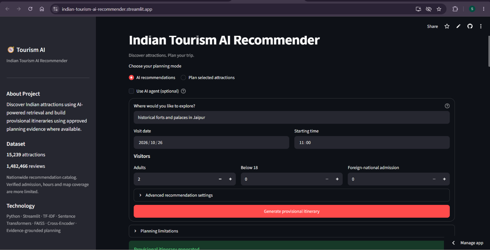
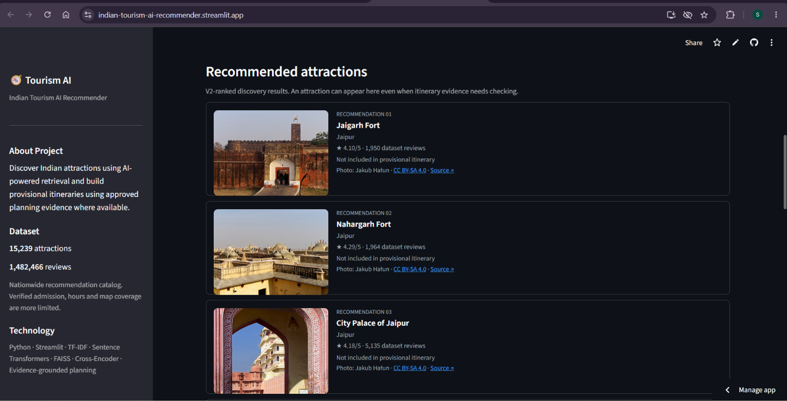
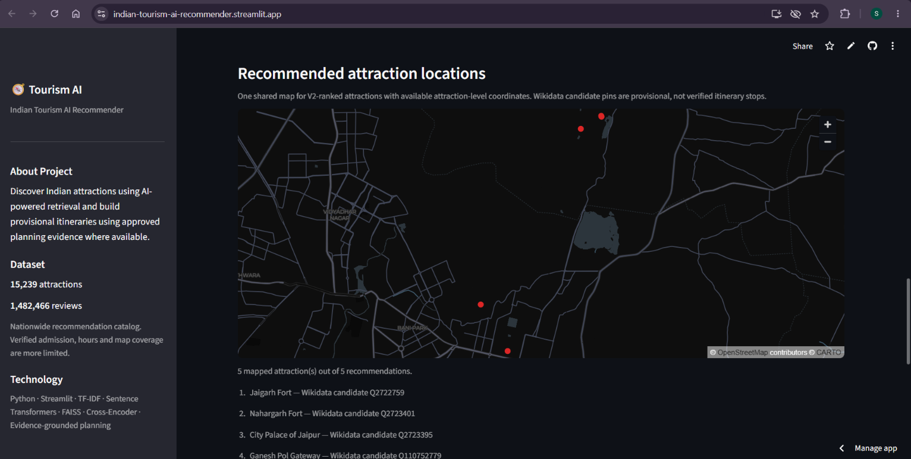
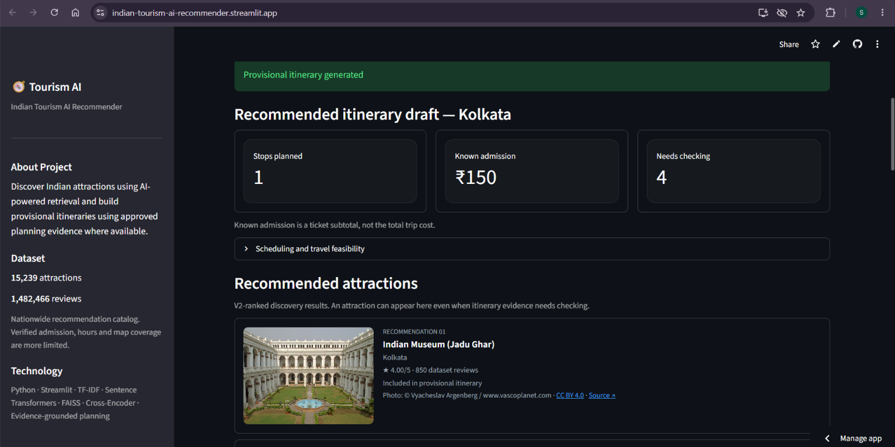

# AI-Powered Indian Tourism Recommender V3

**Hybrid retrieval · Cross-Encoder reranking · Evidence-grounded planning · Interactive attraction discovery**

[**Open the Live Streamlit App**](https://indian-tourism-ai-recommender.streamlit.app/) · [**GitHub Repository**](https://github.com/SayanGhorai/AI-Powered-Indian-Tourism-Recommender)

An end-to-end Indian tourism recommendation and provisional itinerary-planning application developed by **Sayan Ghorai**. The project combines a saved V2 information-retrieval pipeline with a V3 planning interface, attraction photographs, dataset-based ratings, geographic discovery, and PDF export.

The application retrieves relevant places from **15,239 catalog records**, backed by **1,482,466 reviews**. It separates _discovering an interesting attraction_ from _having sufficient evidence to schedule a visit_.

> **Project status:** Deployed on Streamlit Community Cloud. Windows, Linux, and browser testing have been completed for selected workflows. This is a portfolio MVP with documented query, metadata, and geographic-coverage limitations—not a fully verified travel-booking or route-optimization service.

## Overview

A tourism recommender can suggest a relevant place without knowing whether its identity, opening schedule, admission categories, or location are sufficiently supported for itinerary planning. V3 makes that distinction explicit.

The recommendation gallery keeps V2-ranked results visible, including attractions that cannot yet become itinerary stops. The planning layer separately evaluates available evidence and explains why an attraction is included, held for review, or excluded.

The project was developed sequentially: **Kaggle data engineering and model/artifact preparation → local Python and Streamlit development → Linux regression testing → GitHub and Streamlit Cloud deployment**. Saved artifacts are reused rather than regenerated during normal application startup.

## Key Features

- **City-aware hybrid recommendations:** TF-IDF lexical retrieval and SBERT/FAISS semantic retrieval, combined with Reciprocal Rank Fusion and pretrained Cross-Encoder reranking.
- **Compact attraction cards:** Ranked places with dataset ratings, review counts, planning eligibility, photographs when available, and inline image credits.
- **Best-effort media and location discovery:** Registered local photographs take priority over Wikimedia Commons lookup; known attraction coordinates take priority over bounded Wikidata discovery.
- **Evidence-grounded provisional planning:** Identity, operational, admission, and scheduling checks distinguish eligible stops from held or excluded entries.
- **Interactive maps and PDF export:** A shared recommendation map displays available attraction-level pins; PDF reports preserve the provisional planning result and its limitations.
- **Two planning modes and an optional agent:** Discover attractions from a natural-language query or select catalog attractions directly. Optional agent orchestration is separate from the default recommendation workflow.

## Application Screenshots

The screenshots below were captured from the deployed application. They illustrate particular queries and planning inputs, not guaranteed results for every destination or visit date.

### 1. Search and Planning Interface

Enter interests and a destination, choose a visit date and starting time, and specify visitor categories.



### 2. Ranked Attraction Recommendations

Compact cards display attraction photographs, dataset ratings, review counts, planning status, and source attribution.



### 3. Shared Attraction Discovery Map

Available attraction-level coordinates appear together on one discovery map. Wikidata candidate pins remain provisional and do not establish itinerary eligibility or route feasibility.



### 4. Evidence-Grounded Itinerary Example

This recorded Kolkata example contains one eligible provisional stop and a ₹150 known admission subtotal. Eligibility and admission accounting depend on the selected date, visitor categories, and approved evidence; the screenshot is not a current ticket-price guarantee.



## Architecture

```text
Natural-language query
        |
Destination detection and canonicalization
        |
TF-IDF lexical retrieval + SBERT/FAISS semantic retrieval
        |
Reciprocal Rank Fusion + strict city-aware filtering
        |
Pretrained Cross-Encoder reranking
        |
Conservative recommendation and preference policies
        |
V2-ranked attraction results
        |
        +--> Discovery gallery
        |      +--> Dataset ratings and review counts
        |      +--> Registered photos / Wikimedia Commons fallback
        |      +--> Known coordinates / bounded Wikidata fallback
        |
        +--> V3 evidence-grounded planning
               +--> Attraction identity and operational checks
               +--> Admission and requested-date assessment
               +--> Eligible provisional stops / holds / exclusions
               +--> Conservative scheduling and explanations
               +--> Streamlit presentation and PDF export
```

The **Plan selected attractions** mode enters the V3 planning workflow using catalog selections instead of V2-ranked search results. The optional agent selects from approved planning tools; it does not bypass the evidence requirements.

### Recommendation Policy

Cross-Encoder relevance is the primary ranking signal. Conservative recommendation rules support explicit constraints and preferences, while Bayesian/shrunk ratings provide a quality tie-break within relevance groups rather than overriding relevance. Missing sparse metadata is not automatically treated as a positive or negative signal. Aggregated sentiment supports explanations rather than becoming an additional quality score.

The gallery preserves V2 recommendation order. Photo availability and map coverage do not promote an attraction into an approved itinerary stop.

### Discovery Is Not Itinerary Approval

| Application layer          | What it represents                                                        |
| -------------------------- | ------------------------------------------------------------------------- |
| Recommendation card        | A place returned by the recommendation pipeline                           |
| Photograph                 | A registered or automatically matched image with source metadata          |
| Discovery-map pin          | An available attraction-level location, which may be a Wikidata candidate |
| Provisional itinerary stop | A place that passes the current planning evidence checks                  |
| Itinerary-location view    | Confirmed attraction locations associated with eligible stops             |

A place can therefore appear in the gallery and discovery map while remaining excluded from the itinerary.

### Explainability and Grounding

Explanations use available recommendation evidence, dataset ratings, review counts, preference matches, and structured planning records. The RAG layer is intended to present retrieved and supported information—not invent attraction facts, prices, routes, or schedules. The default direct-planning workflow does not require an LLM call.

## Data and Models

### Catalog and Runtime

| Component                 | Project data                           |
| ------------------------- | -------------------------------------- |
| Place catalog             | 15,239 records                         |
| Underlying reviews        | 1,482,466                              |
| Semantic retrieval chunks | 29,442                                 |
| Embedding dimension       | 384                                    |
| Saved production bundle   | 17 tracked files, approximately 93 MiB |

The catalog includes some broader geographic entries as well as individual attractions. These are not all eligible itinerary stops.

Structured attraction enrichment is sparse: the V2 enrichment stage covered **213 catalog places, approximately 1.4%**. This is distinct from the later photograph, coordinate-discovery, and approved planning-evidence layers.

Catalog city-level or destination-level coordinates are **not** used as substitutes for individual attraction pins. For example, multiple attractions may share an inherited city coordinate without having independently established attraction locations.

### Pretrained Models

| Purpose                       | Model                                    |
| ----------------------------- | ---------------------------------------- |
| Semantic query embeddings     | `sentence-transformers/all-MiniLM-L6-v2` |
| Candidate relevance reranking | `cross-encoder/ms-marco-MiniLM-L-6-v2`   |

Model weights may be downloaded and cached by Hugging Face on first use. Normal application operation reuses the saved indexes and pretrained models; it does not require model retraining.

The production bundle is stored at:

```text
production_package/runtime/Indian-Tourism-AI-Recommender-Production/
```

It contains the place catalog, TF-IDF artifacts, FAISS semantic index, retrieval documents, recommendation features, configuration, and policy files. Exported runtime metadata and usage notes are available in `production_manifest.json` and the bundle's `README_RUNTIME.txt`.

## Technology Stack

| Area                             | Technologies                                           |
| -------------------------------- | ------------------------------------------------------ |
| Application                      | Python, Streamlit                                      |
| Data processing                  | pandas, NumPy, PyArrow                                 |
| Lexical retrieval                | TF-IDF, scikit-learn, SciPy                            |
| Semantic retrieval and reranking | Sentence Transformers, Transformers, PyTorch, FAISS    |
| Model distribution               | Hugging Face Hub, safetensors                          |
| Geographic and media discovery   | Wikidata, Wikimedia Commons, standard-library HTTP     |
| PDF generation                   | ReportLab                                              |
| Development and validation       | Kaggle, VS Code, Git, GitHub, Docker-based Linux tests |
| Hosting                          | Streamlit Community Cloud                              |

Verified development/test environments include Windows with **Python 3.12.2**, a Linux test container with **Python 3.12.15**, and **Streamlit 1.65.0**. Exact package versions are maintained in `requirements.txt`.

## Repository Structure

```text
AI-Powered-Indian-Tourism-Recommender/
├── README.md
├── requirements.txt
├── v3_streamlit_app.py                  # V3 application entrypoint
├── .env.example
├── .streamlit/
│   └── config.toml
├── assets/
│   ├── attractions/                    # Registered photos and photo registry
│   └── screenshots/                    # README screenshots
├── src/
│   ├── retrieval.py
│   ├── recommendation.py
│   ├── explainability.py
│   ├── rag.py
│   ├── v3_planning_controller.py
│   ├── v3_itinerary_presenter.py
│   ├── v3_conservative_schedule.py
│   ├── v3_recommendation_gallery.py
│   ├── v3_attraction_media.py
│   ├── v3_recommendation_map.py
│   ├── v3_nationwide_map_lookup.py
│   ├── v3_nationwide_map_merge.py
│   └── ...                             # Additional planning and agent modules
├── v3_data/
│   ├── attraction_evidence.csv
│   ├── evidence_approval_ledger.csv
│   ├── attraction_locations.csv
│   └── ...                             # Source and discovery records
└── production_package/
    └── runtime/
        └── Indian-Tourism-AI-Recommender-Production/
```

Use **`v3_streamlit_app.py`**, not the older `app.py`, to run the V3 interface.

## Local Setup

The following commands use Windows PowerShell. Run the application from the repository root so its relative resource paths resolve correctly.

### 1. Clone the Repository

```powershell
git clone https://github.com/SayanGhorai/AI-Powered-Indian-Tourism-Recommender.git
cd AI-Powered-Indian-Tourism-Recommender
```

### 2. Create the Environment and Install Dependencies

```powershell
py -3.12 -m venv .venv
.\.venv\Scripts\python.exe -m pip install -r requirements.txt
```

The commands invoke the virtual environment's Python directly; activating the environment is optional.

### 3. Run the V3 Application

```powershell
.\.venv\Scripts\python.exe -m streamlit run v3_streamlit_app.py --server.address 127.0.0.1 --server.port 8501
```

Open `http://127.0.0.1:8501` in a browser. Stop the local server with `Ctrl + C`.

The first recommendation may take longer while models and retrieval resources load. Internet access may be needed for initial model downloads and for live photograph/coordinate discovery. The core recommendation pipeline has also been exercised offline with cached models and saved artifacts.

**Do not regenerate the Kaggle artifacts when the verified production bundle is already available.**

## Using the Application

### AI Recommendations

Choose **AI recommendations**, enter a destination and interests, set the visit date, starting time, and visitor categories, then select **Generate provisional itinerary**.

Example queries used during testing:

```text
historical forts and palaces in Jaipur
museums and historical attractions in Kolkata
historical attractions in Mumbai
```

The gallery displays ranked recommendations even when none qualifies for scheduling. Ratings and review counts come from the project's dataset; they are not live Google ratings or continuously refreshed review totals.

### Plan Selected Attractions

Choose a catalog destination and select attractions directly. The same identity, operational, admission, and scheduling safeguards apply. Selecting an attraction does not automatically approve it for an itinerary.

### Optional AI Agent

The **Use AI agent (optional)** control enables a separate tool-selection workflow when the required configuration is available. The optional live provider uses `OPENAI_API_KEY`; normal direct recommendation and planning use does not require that key.

Configure credentials through the environment or the deployment's secret-management mechanism. Do not commit API keys, `.env`, or `.streamlit/secrets.toml`.

The reported three-city cloud acceptance runs used the agent **off**. Their `OFFLINE_DIRECT_PLANNING` status means no live LLM call was used; it does **not** mean that photo APIs, geographic discovery, or browser map tiles operate without internet access.

## Photograph and Map Behavior

### Photographs

The application prefers registered local photographs matched by catalog place ID. When none exists, it attempts Wikimedia Commons discovery and displays available photographer, source, and license information. Thumbnails use a compact 4:3 display frame; portrait images may be visually cropped.

Photo lookup is best-effort. An automatic match can show an interior, exhibit, or associated view rather than a building exterior. An unavailable result leaves the recommendation visible with **Photo unavailable**.

### Geographic Discovery

The shared map prioritizes user-confirmed attraction coordinates and existing identity-matched Wikidata candidates. Missing locations can be looked up through the nationwide discovery helper.

The current UI requests at most **three new attraction lookups and six Wikidata API attempts per batch**. Successful coordinate results use a bounded, in-process cache with a 24-hour lifetime and a maximum of 512 entries. A rate-limit response stops further new coordinate requests in that batch, while existing cached results remain usable.

These limits apply to coordinate discovery, not photograph requests or model downloads. The cache is not persistent across process restarts. Exact-name and city-context matching can miss legitimate attractions with alternative labels or incomplete descriptions.

Unmatched recommendations stay in the gallery without invented pins. Discovery coordinates never become approved itinerary evidence automatically.

## Planning Evidence and PDF Export

The planner reports explicit reasons for withholding or excluding attractions, including:

| Status                          | Meaning                                                       |
| ------------------------------- | ------------------------------------------------------------- |
| `HOLD_IDENTITY_VERIFICATION`    | Attraction identity requires further verification             |
| `HOLD_OPERATIONAL_VERIFICATION` | Opening or operational evidence is insufficient               |
| `EXCLUDED_CITY_LEVEL`           | Record cannot be treated as an individual attraction          |
| `EXCLUDED_SCHEDULE`             | Approved schedule evidence conflicts with the requested visit |

Known admission is a subtotal for applicable included stops, **not the total trip cost**. A zero-stop itinerary can still accompany useful discovery recommendations.

PDF exports include the destination, requested date/time, planning source, eligible stops, held/excluded entries, admission accounting, available approved evidence references, and scheduling limitations. They do not turn discovery-only recommendations into scheduled stops.

Travel times, unverified visit durations, route optimization, and full-day feasibility are not invented. Later-stop arrival times can remain unscheduled, and published opening information does not guarantee live admission or ticket availability.

## Validation and Observed Behavior

Validation has included source/checkpoint checks, Linux module imports, Streamlit startup and session tests, CPU inference with cached models, photo/map integration tests, mocked API failures and rate limits, identity-mismatch rejection, cache/budget regressions, PDF generation checks, and browser testing.

Selected Linux tests ran with read-only project/model mounts, disabled network access, and a 4 GiB container memory limit. Mocked API tests establish application behavior under controlled inputs; they do not measure real nationwide coverage.

### Recorded Acceptance Examples

| Test destination/query                       | Recommendations | Photos reported | Mapped attractions | Observed planning result                                                       |
| -------------------------------------------- | --------------: | --------------: | -----------------: | ------------------------------------------------------------------------------ |
| Jaipur — historical forts and palaces        |               5 |               5 |                  5 | No eligible stops; evidence review required                                    |
| Kolkata — museums and historical attractions |               5 |               3 |                  1 | Date-dependent; eligible museum stop in one run, schedule exclusion in another |
| Mumbai — historical attractions              |               5 |               4 |                  3 | No eligible stops; evidence review required                                    |
| Varanasi — temples and ghats                 |               5 |               5 |                  0 | Recommendations returned; no eligible stops                                    |
| Manali — scenic mountain attractions         |               5 |               1 |                  0 | Recommendations returned; limited media/location coverage                      |
| Agra — historical monuments                  |               5 |               3 |                  0 | Recommendations returned; no eligible stops                                    |
| Goa — best beaches                           |   Not generated |               — |                  — | Technical error; diagnosis deferred                                            |

These are recorded application outputs, not a recommendation-accuracy benchmark or a guarantee of repeatable external API results. Missing map coordinates do not establish that no geographic data exists elsewhere.

### Earlier Local Performance Observations

| Windows observation                      | Approximate measurement |
| ---------------------------------------- | ----------------------: |
| Initial Streamlit render                 |           12.55 seconds |
| First tested V2 recommendation           |           12.86 seconds |
| Warm subsequent recommendation           |            1.26 seconds |
| Working set after inference              |                 1.0 GiB |
| Private committed memory after inference |                 2.6 GiB |

These measurements describe earlier local runs with different queries. They are not end-to-end benchmarks for every media-enriched V3 request, cloud latency guarantees, or hosting memory requirements.

## Known Limitations and Deferred Work

- **Destination edge cases:** The tested `best beaches in Goa` request produced a technical error. The underlying cause has not yet been established.
- **Uneven photo and map coverage:** Availability depends on source metadata, matching rules, external APIs, and request budgets. Nationwide lookup capability does not imply complete coverage of all catalog places.
- **Sparse planning evidence:** Many recommendations remain on hold. City-level geographic records can also appear in the discovery gallery while being excluded from the itinerary.
- **Recommendation quality needs broader evaluation:** Sparse-review attractions can rank highly. Dataset ratings, small review counts, and a successful UI test do not establish recommendation accuracy.
- **Presentation refinements remain:** Some imported image credits contain duplicated author text; some generic PDF wording could distinguish coordinate provenance more clearly.
- **Planning is provisional:** No verified travel route, complete daily schedule, live admission guarantee, or booking capability is claimed.

Deferred maintenance priorities include destination edge cases, media/location coverage, relevance evaluation, and presentation wording.

## Deployment and Repository Safety

The live application runs on **Streamlit Community Cloud** with `v3_streamlit_app.py` as its entrypoint. The UI21 production update incorporated ten feature commits into `main`; the verified application release checkpoint is:

```text
34b70118fb1b503a51d1d18788cfdcb43f283f18
```

The deployed application requires the tracked production bundle, V3 evidence files, registered assets, and pinned Python dependencies. Pretrained weights may require download/cache space. External media and coordinate services remain runtime dependencies for their respective optional discovery features.

Do not commit virtual environments, API credentials, local research directories, temporary backups, or redundant Kaggle checkpoints. Keep required source modules, runtime artifacts, evidence records, and production assets tracked. Use `requirements.txt` as the dependency source of truth.

Displayed photographs retain source credits and applicable license references. Third-party images, datasets, models, and map layers have their own attribution and usage terms.

## Author

**Sayan Ghorai** — individual project development across data preparation, retrieval, recommendation, evidence-grounded planning, interface development, testing, and deployment.

[GitHub Profile](https://github.com/SayanGhorai) · [Live Application](https://indian-tourism-ai-recommender.streamlit.app/)
